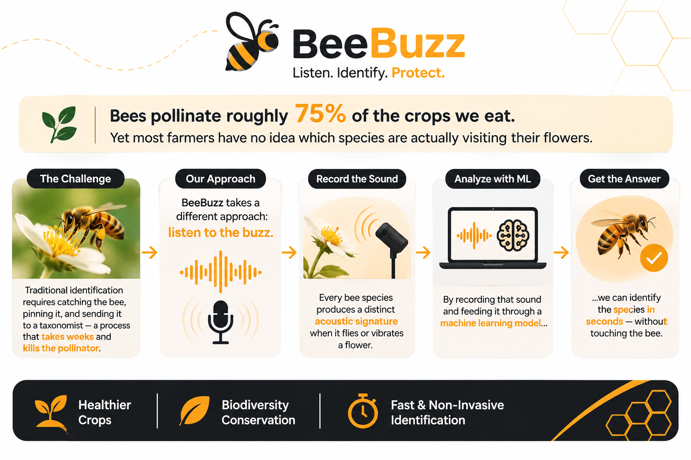
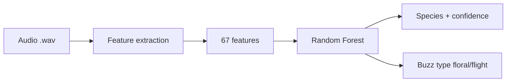

<div align="center">


# BeeBuzz

### *Classifying bees by the sound of their buzz.*

[](https://creativecommons.org/licenses/by/4.0/)
[](https://www.python.org/downloads/)
[](https://github.com/DataTalksClub/machine-learning-zoomcamp)
[](https://github.com/marcos-Nieves-24/machine-learning-zoomcamp/tree/main/project/beebuzz/tests)
[](https://github.com/marcos-Nieves-24/machine-learning-zoomcamp/tree/main/project/beebuzz/api/Dockerfile)

</div>

---

<div align="center">

<a href="https://github.com/marcos-Nieves-24/machine-learning-zoomcamp/raw/main/project/beebuzz/docs/screenshots/dashboard-main.png">
  
</a>

*Predict tab (click to enlarge).*

<details>
<summary>More screenshots (Results, About)</summary>

<br/>

<a href="https://github.com/marcos-Nieves-24/machine-learning-zoomcamp/raw/main/project/beebuzz/docs/screenshots/dashboard-results.png">
  
</a>

*My results tab.*

<a href="https://github.com/marcos-Nieves-24/machine-learning-zoomcamp/raw/main/project/beebuzz/docs/screenshots/dashboard-about.png">
  
</a>

*About tab with model info and SHAP plots.*

</details>

</div>

---

## The problem

<div align="center">



</div>

---

## What it does

BeeBuzz reads buzzing sounds through acoustic features like fundamental frequency and MFCC, and predicts which of five bee species made the sound. A second model predicts the buzz type. Floral buzzes happen when a bee vibrates a flower to release pollen, so they signal active pollination. Flight buzzes happen between flowers.

---

## Results

We held out a stratified 20% (seed 42, n=40) before any tuning, ran 5-fold CV with 20 Optuna trials on the remaining 80%, and scored the winner once on the holdout.

### Species classification (5 classes)

| Model | Train CV acc | Train CV macro-F1 | Holdout acc | Holdout macro-F1 |
|-------|--------------|-------------------|-------------|------------------|
| Dummy (majority) | 18.8% | 0.13 | — | — |
| LDA | 53.1% | 0.53 | — | — |
| Logistic Regression | 65.6% | 0.66 | — | — |
| XGBoost (default) | 77.5% | 0.78 | — | — |
| RF (tuned, Optuna) | 79.4% | 0.80 | — | — |
| **RF (default — best)** | **80.0%** | **0.80** | **80.0%** | **0.80** |

Per species on the holdout (8 samples each): *Bombus morio* F1 0.88, Oxaea verdinha 0.88, Banguela sp. 0.74, Xylocopa pretinha 0.80, Centris cinza 0.71 with recall 0.62, the weakest of the five.

That 80% comes from 40 lab recordings, so read it as a midterm estimate rather than expected field performance.

### Calibration (holdout)

Brier (OvR mean) 0.084, ECE 0.31. The API returns the forest vote share as confidence, which runs overconfident. It is not a calibrated probability.

<details>
<summary>Confusion matrix and calibration curve</summary>

<br/>


*Confusion matrix, holdout (n=40).*


*Calibration curve on max probability. Points below the diagonal mean overconfidence.*

</details>

### Buzz type classification (floral vs flight)

| Model | Holdout acc (n=40) |
|-------|--------------------|
| RF (default) | 100% |

One caution: filename prefix (`B_` floral vs `V_` flight) predicts the label perfectly, so this score likely reflects recording setup rather than biology. Read it as a data quality warning, not a biological result.

<details>
<summary>Why is buzz type ~100% but species only 80%?</summary>

Floral sonication and flight buzz differ a lot in duration, frequency and amplitude. Telling five species apart means catching small differences in timbre, which is harder. Each event is an independent recording, so the gap reflects task difficulty, not a leak between train and test.

</details>

### Comparison with the source paper

<details>
<summary>Expand to see detailed comparison</summary>

The original paper reports 95% accuracy (combined) using 182 features (cinematic band power from raw audio files among them) and 1000 random train/test splits. Our 80.0% (holdout, n=40) uses 67 features from the pre-extracted CSV with one held out split. The gap comes down to three things:

1. Extra cinematic features (band power around 310 to 400 Hz and similar) that need raw .txt files not included in the CSV.
2. Validation: 1000 random splits with a 33% holdout against our single stratified 80/20 split. Random resampling can leak events from the same individual across splits and inflate the score.
3. Sample size: 518 samples in the paper against 200 events in our subset.

Tuning did not beat the defaults, which is worth reporting as is. SHAP is our addition for explaining predictions.

</details>

---

## Species

Five bee species from the Mendeley Buzz Pollination dataset, recorded on blueberry flowers in Brazil:

| Morphotype | Scientific name | Family |
|---|---|---|
| Banguela sp. | *Cadeguala occidentalis* | Colletidae |
| *Bombus morio* | *Bombus morio* | Apidae |
| Centris cinza | *Centris cineraria* | Apidae |
| Oxaea verdinha | *Oxaea flavescens* | Andrenidae |
| Xylocopa pretinha | *Xylocopa* sp. | Apidae |

---

## How it works



The model takes pre-extracted features and returns the predicted species with a confidence score between 0 and 1, the full probability distribution across species, and the buzz type.

SHAP puts fundamental frequency first for every species, then the first three MFCCs and duration.

<details>
<summary>View SHAP summary plot</summary>


</details>

---

## Getting started

### Prerequisites

- Python 3.11+
- pip or conda

### Installation

```bash
git clone <repo-url>
cd project/beebuzz

python3 -m venv .venv
source .venv/bin/activate
pip install -r requirements.txt
```

### Train the model

```bash
python src/train.py
```

This trains 5 models (Dummy, LDA, Logistic Regression, Random Forest, XGBoost), runs Optuna tuning on RF, and saves the best model to `models/model.joblib`.

### Run the API

```bash
uvicorn api.app:app --app-dir . --port 8000
```

Endpoints:
- `GET /health` — service status
- `POST /predict` — species classification
- `POST /predict/type` — buzz type classification

### Run the dashboard

```bash
streamlit run dashboard/app.py
```

Opens at `http://localhost:8501`. Upload a CSV or enter features manually. Bilingual (EN/ES).

### Docker

```bash
docker build -f api/Dockerfile -t beebuzz .
docker run -p 8000:8000 beebuzz
```

---

## Project structure

<details>
<summary>Expand to see full project tree</summary>

```
beebuzz/
├── data/raw/buzz_data.csv          # Mendeley dataset (200 events, 5 species)
├── notebooks/
│   ├── 01_eda.ipynb               # Exploratory data analysis
│   └── 02_models.ipynb            # Model training + SHAP
├── src/
│   ├── features.py                 # Feature engineering
│   ├── train.py                    # Training + tuning + evaluation
│   ├── predict.py                  # Inference
│   └── shap_analysis.py            # SHAP explainability
├── models/
│   ├── model.joblib                # Best species classifier (RF)
│   ├── model_type.joblib           # Buzz type classifier (RF)
│   └── feature_config.json         # Features, classes, metrics
├── api/
│   ├── app.py                      # FastAPI service
│   ├── requirements.txt
│   └── Dockerfile
├── dashboard/
│   ├── app.py                      # Streamlit dashboard (bilingual)
│   ├── logo.svg                    # Primary logo
│   ├── logo-light.svg              # Light theme variant
│   ├── logo-horizontal.svg         # Horizontal lockup
│   ├── logo-small.svg              # Favicon (16px)
│   ├── brand-guidelines.md         # Brand system
│   ├── variants/                   # Black, white, mono, square, favicon, app-icon
│   └── reports/                    # SHAP plots
├── tests/
│   └── smoke_test.py               # 4 smoke tests
├── scripts/
│   └── download_data.py            # Download dataset from GitHub
├── reports/
│   ├── shap_summary.png
│   └── shap_bar.png
├── docs/screenshots/
│   ├── dashboard-main.png
│   ├── dashboard-results.png
│   └── dashboard-about.png
├── requirements.txt
└── README.md
```

</details>

---

## Limitations

- Only five species, a subset of the 16 in the source paper.
- 200 events is small, so results may not generalize.
- Lab recordings with no field noise, distance or weather variation.
- The API takes pre-extracted features, not raw audio.
- Some species carry morphotype labels (common names in Portuguese) rather than formal taxonomy.

---

## Data & license

- **Dataset:** Mendeley Data — Dual-Signal Buzz Pollination (CC BY 4.0).
- **Paper:** Arvelos et al. (2025), "Dual-Signal Buzz Pollination Monitoring: How Flight and Floral Vibrations Complement Each Other to Improve Bee Species Identification."
- **Code:** GitHub — Caarvelos/Bee-acoustics-classification.
- **License:** CC BY 4.0. Cite the Mendeley Data DOI and the paper when reusing.

---

## Acknowledgments

- Mendeley Data and the authors of the original dataset.
- ML Zoomcamp 2026 (DataTalks.Club) for the course structure.
- The bees, for their cooperation.

---

<div align="center">


*BeeBuzz — ML Zoomcamp 2026 Midterm*

</div>
