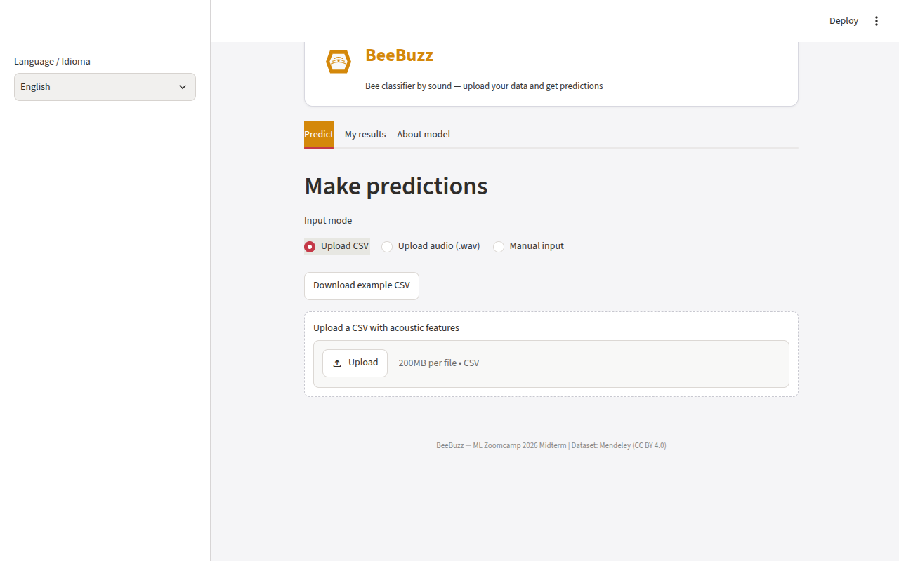
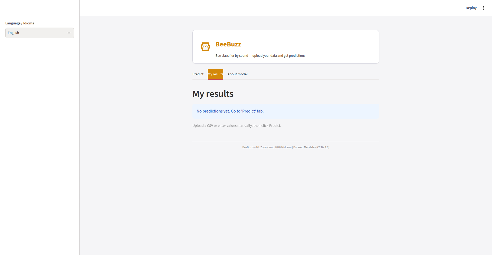
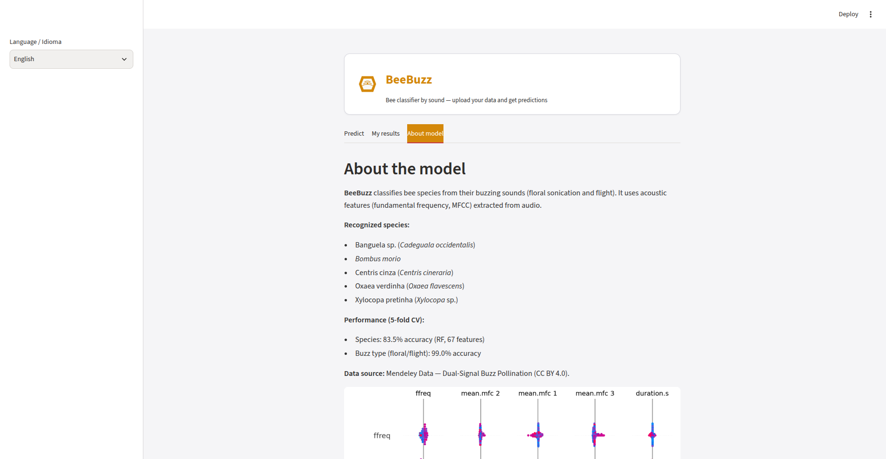
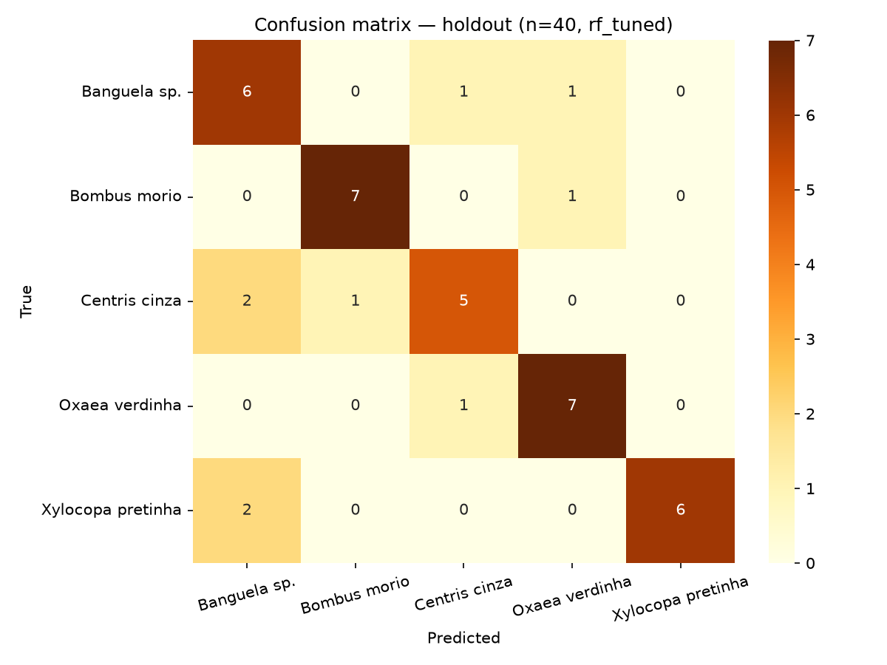
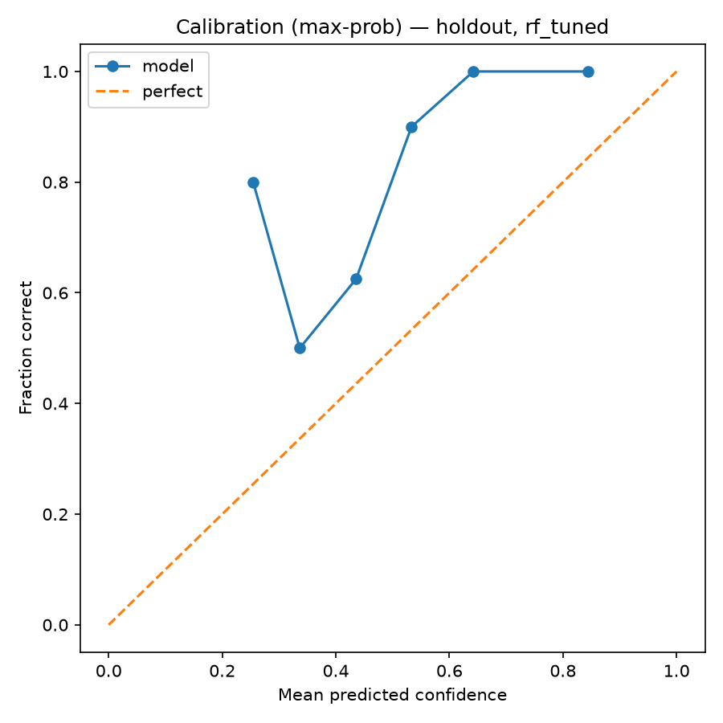
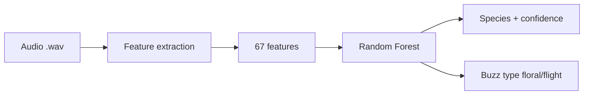
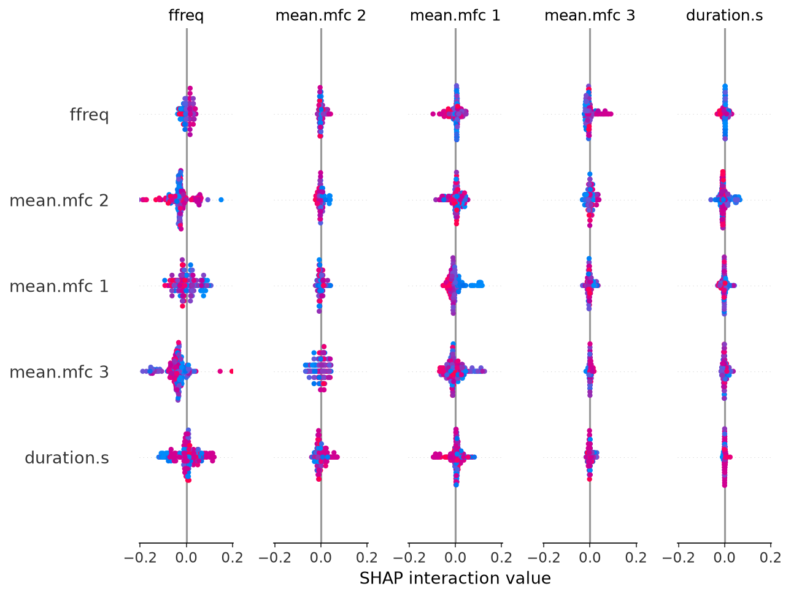

<div align="center">


# BeeBuzz

### *Classifying bees by the sound of their buzz.*

[](https://creativecommons.org/licenses/by/4.0/)
[](https://www.python.org/downloads/)
[](https://github.com/DataTalksClub/machine-learning-zoomcamp)
[](https://github.com/marcos-Nieves-24/machine-learning-zoomcamp/tree/main/project/beebuzz/tests)
[](https://github.com/marcos-Nieves-24/machine-learning-zoomcamp/tree/main/project/beebuzz/api/Dockerfile)

</div>

---

<div align="center">

<a href="https://github.com/marcos-Nieves-24/machine-learning-zoomcamp/raw/main/project/beebuzz/docs/screenshots/dashboard-main.png">
  
</a>

*BeeBuzz dashboard — Predict tab. Upload a CSV or enter values manually. Click to enlarge.*

</div>

<div align="center">

<a href="https://github.com/marcos-Nieves-24/machine-learning-zoomcamp/raw/main/project/beebuzz/docs/screenshots/dashboard-results.png">
  
</a>

*My results tab — statistics of your predictions.*

<a href="https://github.com/marcos-Nieves-24/machine-learning-zoomcamp/raw/main/project/beebuzz/docs/screenshots/dashboard-about.png">
  
</a>

*About tab — model info and SHAP explainability.*

</div>

---

## The problem

Bees pollinate roughly **75% of the crops we eat**. Yet most farmers have no idea which species are actually visiting their flowers. Traditional identification requires catching the bee, pinning it, and sending it to a taxonomist — a process that takes weeks and kills the pollinator.

**BeeBuzz takes a different approach: listen to the buzz.**

Every bee species produces a distinct acoustic signature when it flies or vibrates a flower. By recording that sound and feeding it through a machine learning model, we can identify the species in seconds — without touching the bee.

---

## What it does

BeeBuzz classifies bee species from their buzzing sounds using acoustic features (fundamental frequency, MFCC). It also distinguishes between two types of buzz:

- **Floral buzz** — the bee vibrating a flower to extract pollen (buzz pollination / sonication)
- **Flight buzz** — the bee flying between flowers

A second model classifies the buzz type, which matters for pollination monitoring: a floral buzz means the bee is actively pollinating, while a flight buzz means it's just passing through.

---

## Results

Trained and evaluated with an honest protocol: stratified 80/20 holdout (seed 42) reserved BEFORE tuning; 5-fold CV + Optuna (20 trials) on train only; final eval once on untouched holdout (n=40).

### Species classification (5 classes)

| Model | Train CV acc | Train CV macro-F1 | Holdout acc | Holdout macro-F1 |
|-------|--------------|-------------------|-------------|------------------|
| Dummy (majority) | 18.8% | 0.13 | — | — |
| LDA | 53.1% | 0.53 | — | — |
| Logistic Regression | 65.6% | 0.66 | — | — |
| XGBoost (default) | 77.5% | 0.78 | — | — |
| RF (tuned, Optuna) | 79.4% | 0.80 | — | — |
| **RF (default — best)** | **80.0%** | **0.80** | **80.0%** | **0.80** |

Holdout per species (n=40, 8 per class): *Bombus morio* F1 0.88, Oxaea verdinha 0.88, Banguela sp. 0.74, Xylocopa pretinha 0.80, Centris cinza 0.71 (recall 0.62 — the weakest).

**Do NOT present 80% as field-ready accuracy.** With n=40 the 95% interval is wide, and lab recordings do not represent field conditions.

### Calibration (holdout)

Brier (OvR mean) 0.084, ECE 0.31. The confidence returned by the API is RF vote frequency, **not** a calibrated probability — the model is overconfident.



*Confusion matrix — holdout (n=40).*



*Calibration curve (max-prob) — holdout. Below diagonal = overconfident.*

### Buzz type classification (floral vs flight)

| Model | Holdout acc (n=40) |
|-------|--------------------|
| RF (default) | 100% |

Caveat: filename prefix (`B_` floral vs `V_` flight) perfectly predicts the label. This likely reflects recording setup, not biology. Treat as a data-quality warning, not a biological result.

<details>
<summary>Why is buzz type ~100% but species only 80%?</summary>

Floral sonication and flight buzz are acoustically very different (duration, frequency, amplitude). Distinguishing 5 bee species requires detecting subtle differences in timbre (MFCC shape), which is harder. The 99% is realistic — not leakage — because each event is an independent recording.
</details>

### Comparison with the source paper

<details>
<summary>Expand to see detailed comparison</summary>

The original paper reports 95% accuracy (combined) using 182 features (including cinematic band-power extracted from raw audio files) and 1000 random train/test splits. Our 80.0% (holdout, n=40) uses 67 features from the pre-extracted CSV with an honest 80/20 holdout. The gap is explained by:

1. **Additional cinematic features** (band-power 310–400 Hz, etc.) that require raw .txt files not included in the CSV.
2. **Validation strategy** — 1000 random splits (33% hold-out) vs. 5-fold stratified CV. Random splits can inflate metrics through data leakage between events from the same individual.
3. **Dataset size** — 518 samples (paper) vs. 200 events (our subset).

We also added **SHAP explainability** and **Optuna tuning** (which, honestly, did not improve over defaults — a result worth documenting).

</details>

---

## Species

Five bee species from the Mendeley Buzz Pollination dataset, recorded on blueberry flowers in Brazil:

| Morphotype | Scientific name | Family |
|---|---|---|
| Banguela sp. | *Cadeguala occidentalis* | Colletidae |
| *Bombus morio* | *Bombus morio* | Apidae |
| Centris cinza | *Centris cineraria* | Apidae |
| Oxaea verdinha | *Oxaea flavescens* | Andrenidae |
| Xylocopa pretinha | *Xylocopa* sp. | Apidae |

---

## How it works



The model receives pre-extracted acoustic features (fundamental frequency, MFCC) and returns:

- **Species** — which bee is buzzing
- **Confidence** — how sure the model is (0–1)
- **Probabilities** — score for each species
- **Buzz type** — floral (pollinating) or flight (just passing)

SHAP analysis shows that **fundamental frequency (ffreq)** is the most discriminative feature for all species, followed by the first 3 MFCCs and duration.

<details>
<summary>View SHAP summary plot</summary>



</details>

---

## Getting started

### Prerequisites

- Python 3.11+
- pip or conda

### Installation

```bash
git clone <repo-url>
cd project/beebuzz

python3 -m venv .venv
source .venv/bin/activate
pip install -r requirements.txt
```

### Train the model

```bash
python src/train.py
```

This trains 5 models (Dummy, LDA, Logistic Regression, Random Forest, XGBoost), runs Optuna tuning on RF, and saves the best model to `models/model.joblib`.

### Run the API

```bash
uvicorn api.app:app --app-dir . --port 8000
```

Endpoints:
- `GET /health` — service status
- `POST /predict` — species classification
- `POST /predict/type` — buzz type classification

### Run the dashboard

```bash
streamlit run dashboard/app.py
```

Opens at `http://localhost:8501`. Upload a CSV or enter features manually. Bilingual (EN/ES).

### Docker

```bash
docker build -f api/Dockerfile -t beebuzz .
docker run -p 8000:8000 beebuzz
```

---

## Project structure

<details>
<summary>Expand to see full project tree</summary>

```
beebuzz/
├── data/raw/buzz_data.csv          # Mendeley dataset (200 events, 5 species)
├── notebooks/
│   ├── 01_eda.ipynb               # Exploratory data analysis
│   └── 02_models.ipynb            # Model training + SHAP
├── src/
│   ├── features.py                 # Feature engineering
│   ├── train.py                    # Training + tuning + evaluation
│   ├── predict.py                  # Inference
│   └── shap_analysis.py            # SHAP explainability
├── models/
│   ├── model.joblib                # Best species classifier (RF)
│   ├── model_type.joblib           # Buzz type classifier (RF)
│   └── feature_config.json         # Features, classes, metrics
├── api/
│   ├── app.py                      # FastAPI service
│   ├── requirements.txt
│   └── Dockerfile
├── dashboard/
│   ├── app.py                      # Streamlit dashboard (bilingual)
│   ├── logo.svg                    # Primary logo
│   ├── logo-light.svg              # Light theme variant
│   ├── logo-horizontal.svg         # Horizontal lockup
│   ├── logo-small.svg              # Favicon (16px)
│   ├── brand-guidelines.md         # Brand system
│   ├── variants/                   # Black, white, mono, square, favicon, app-icon
│   └── reports/                    # SHAP plots
├── tests/
│   └── smoke_test.py               # 3 smoke tests
├── scripts/
│   └── download_data.py            # Download dataset from GitHub
├── reports/
│   ├── shap_summary.png
│   └── shap_bar.png
├── docs/screenshots/
│   ├── dashboard-main.png
│   ├── dashboard-results.png
│   └── dashboard-about.png
├── requirements.txt
└── README.md
```

</details>

---

## Limitations

- **5 species only** — subset of the 16 in the source paper.
- **200 events** — small dataset, results may not generalize.
- **Lab recordings** — no field noise, distance, or weather variation.
- **No audio endpoint** — the API receives pre-extracted features, not raw audio. Audio upload is planned for the capstone.
- **Morphotype labels** — some species are identified by morphotype (common names in Portuguese), not formal taxonomy.

---

## Data & license

- **Dataset:** Mendeley Data — Dual-Signal Buzz Pollination (CC BY 4.0).
- **Paper:** Arvelos et al. (2025), "Dual-Signal Buzz Pollination Monitoring: How Flight and Floral Vibrations Complement Each Other to Improve Bee Species Identification."
- **Code:** GitHub — Caarvelos/Bee-acoustics-classification.
- **License:** CC BY 4.0. Cite the Mendeley Data DOI and the paper when reusing.

---

## Acknowledgments

- Mendeley Data and the authors of the original dataset.
- ML Zoomcamp 2026 (DataTalks.Club) for the course structure.
- The bees, for their cooperation.

---

<div align="center">


*BeeBuzz — ML Zoomcamp 2026 Midterm*

</div>
